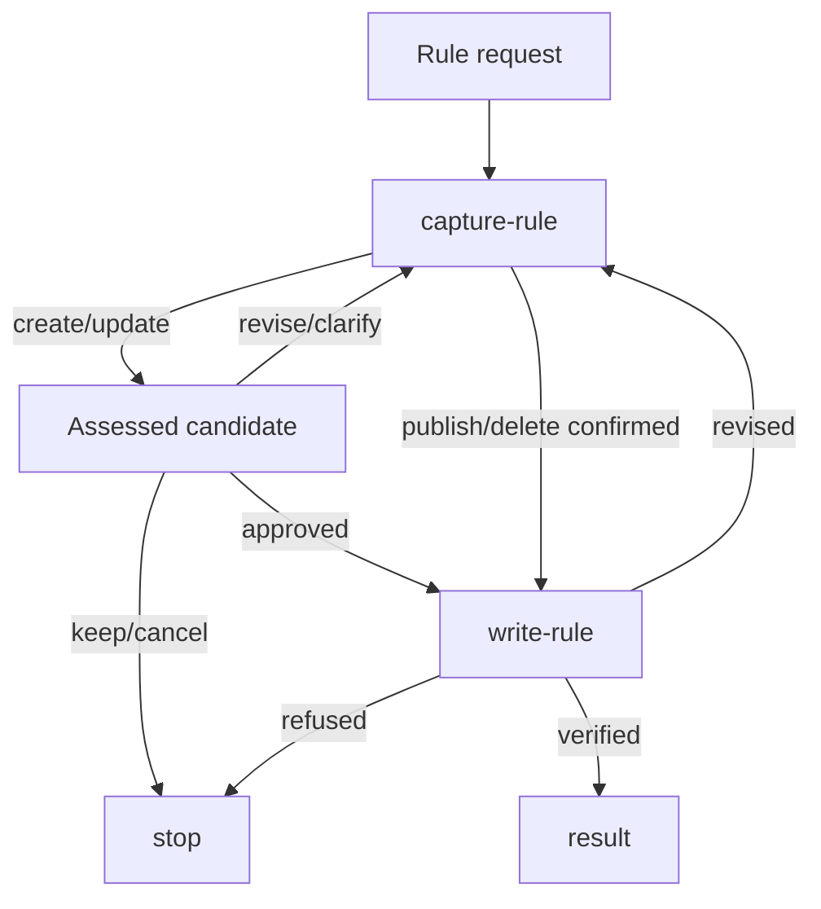

# Rule Generate

## Actions

Follow the flow. Read only the next action and its references.

| Action | Does |
| --- | --- |
| capture-rule | frame, compare, plan, decide |
| write-rule | write the approved result, verify |

## Transversal rules

- Report unsupported hosts with alternatives; a lone AGENTS file identifies no installed host.
- Stop and name any installed reference that cannot be read.
- Change existing sources or publications only with explicit permission naming them.
- Write only after the user approves the candidate shown last. A choice, merge, edit or rename is not an approval: show the revision and wait.
- Keep or cancel leaves project bytes unchanged.
