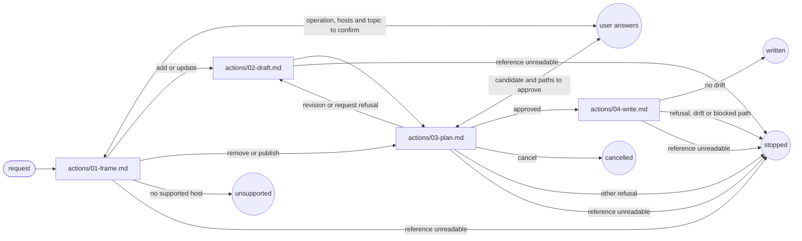

# Rule Generate

## Transversal rules

- If a cited reference cannot be read, stop and name it.
- Write only after the user approves the candidate shown last.
- Name each existing source or publication the write changes.
