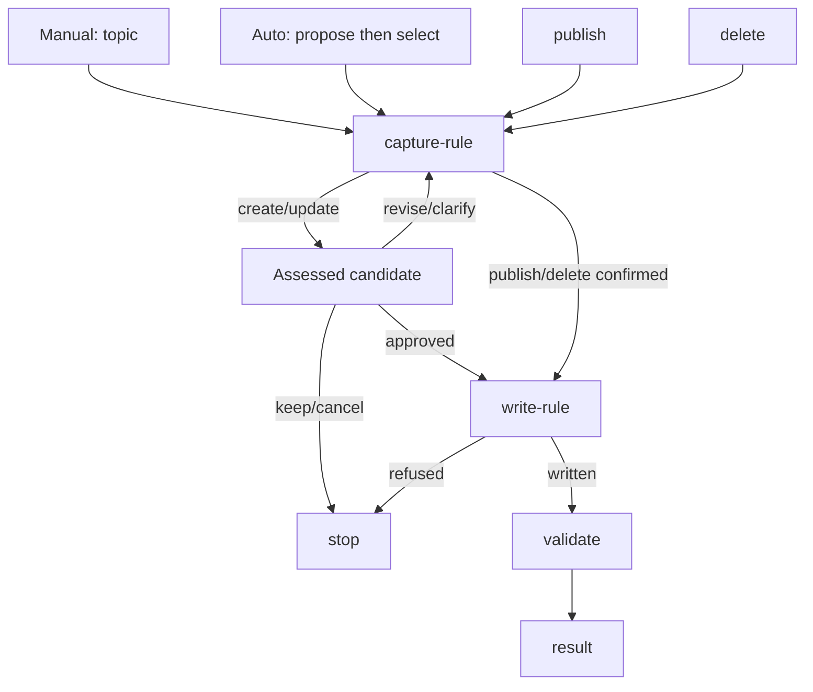

# Rule Generate

## Actions

Read only the next action in `actions/` and its cited reference sections.

| Action | Does |
| --- | --- |
| capture-rule | frame, compare and decide |
| write-rule | publish the approved result |
| validate | check affected files |

## Transversal rules

- Missing/unreadable installed reference: stop.
- Create/update: capture confirmation is not approval. Present the full assessed candidate, including new; await subsequent user approval before any rule/request/publication write. Repeat after candidate/resolution/evidence changes.
- Existing changes require explicit identified-source/publication permissions.
- Keep/cancel leaves project bytes unchanged.
