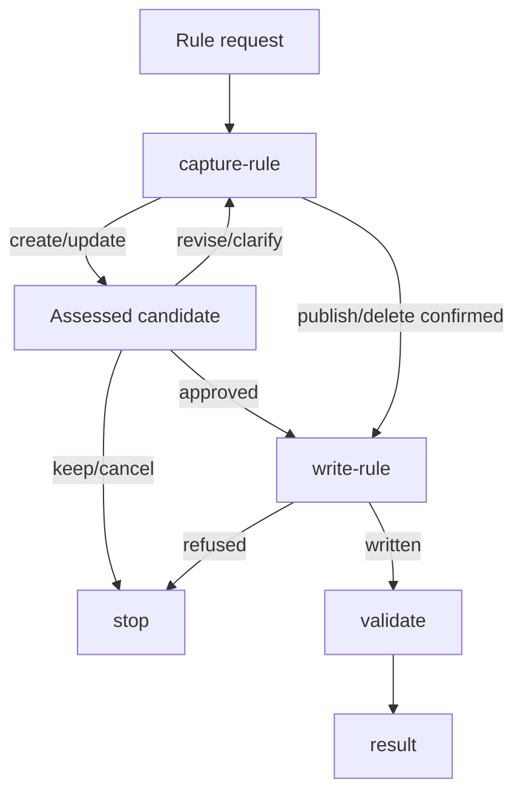

# Rule Generate

## Actions

Read the next action in `actions/` and its references.

| Action | Does |
| --- | --- |
| `01-capture-rule.md` | frame, compare and decide |
| `02-write-rule.md` | publish the approved result |
| `03-validate.md` | check affected files |

## Transversal rules

- Missing/unreadable installed reference: stop.
- Create/update: present full assessed candidates, including new; await approval after capture confirmation before any rule/request/publication write. Renew after candidate/resolution/evidence changes.
- Existing changes require explicit identified-source/publication permissions.
- Keep/cancel leaves project bytes unchanged.
