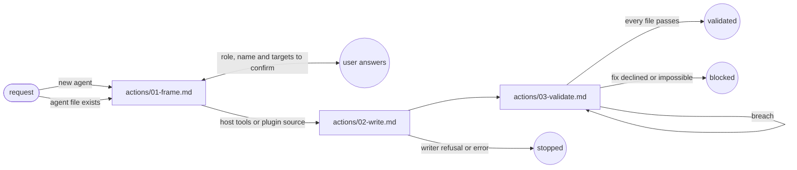

# Agent Generate

## Transversal rules

- If a cited reference cannot be read, stop and report the missing file.
- Keep the meaning of each line of an existing agent, unless the request changes it.
