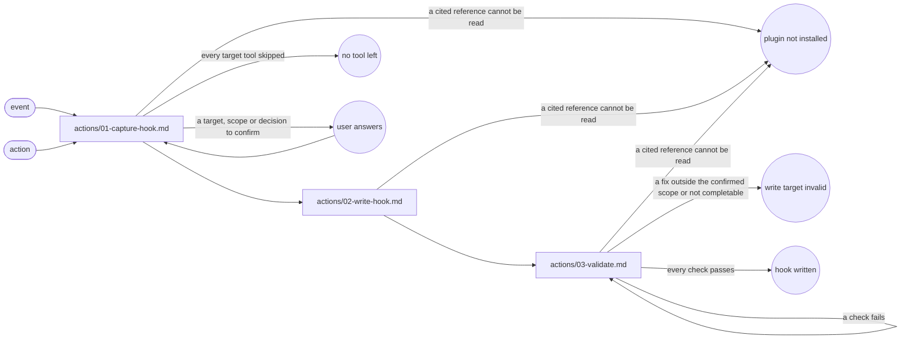

# Hook Generate

## Transversal rules

- If a cited reference cannot be read, stop and report that the plugin is not installed in this host.
- Write every file in English, unless the user asks otherwise.
