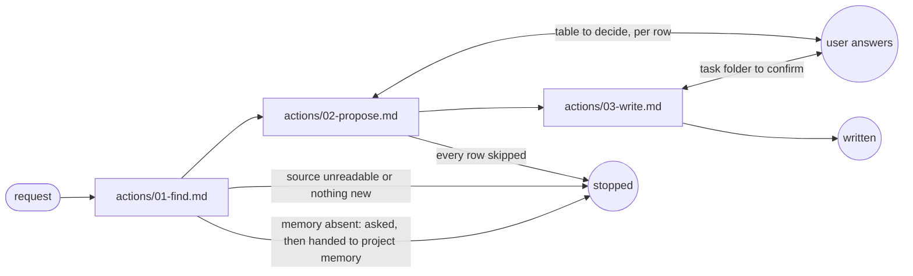

# Learn

## Transversal rules

- If a cited reference cannot be read, stop and report the missing file.
- Write only what the user validated.
- Touch only the files a lesson names.
- Write project files only, never personal or global memory.
