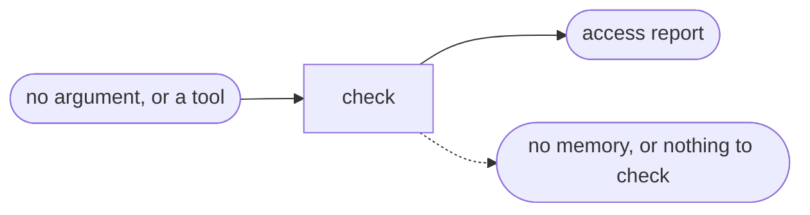

# Access Check

## Actions

Run the flow above, reading the action file first.

| Action | Does                                         |
| ------ | -------------------------------------------- |
| check  | probe each access in memory, print the report |

## Transversal rules

- Read-only: no writes, installs, login flows, configuration or memory changes.
- Never print a secret, a token or a credential file's content.
- A configured tool never proves access. Only a read matching the intended account and target does.
- One access failing never stops the others.
