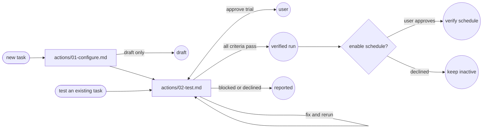

# Scheduled tasks

## Transversal rules

- For a new task, start by reading [configure](actions/01-configure.md).
- For a test request on an existing task, start by reading [test](actions/02-test.md).
- Until the user explicitly approves executing the trial, inspect workflow skills and their data read-only, and never invoke a workflow step or write its destination.
