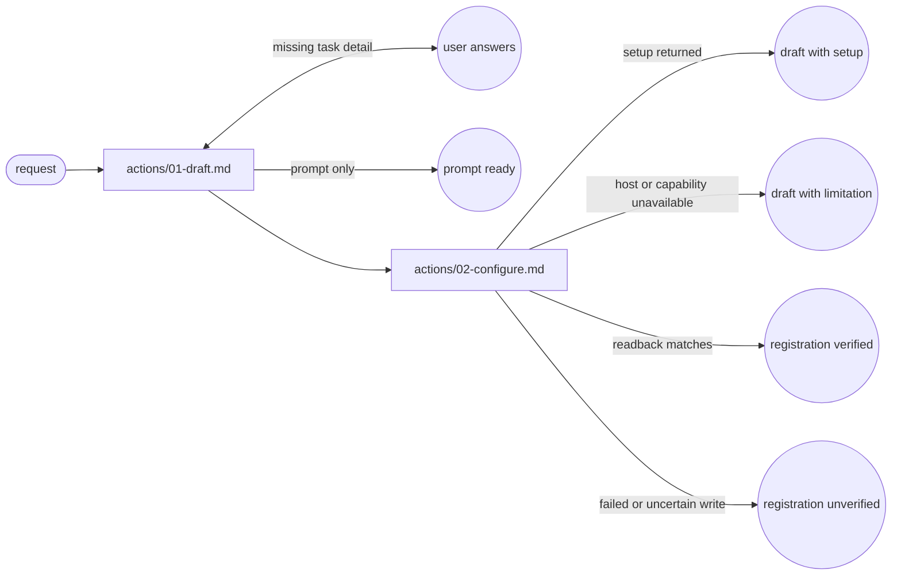

# Generate a scheduled task

## Transversal rules

- Begin by reading [Draft the task](actions/01-draft.md) in this skill directory.
- Read each action and the asset it calls for before returning its result.
