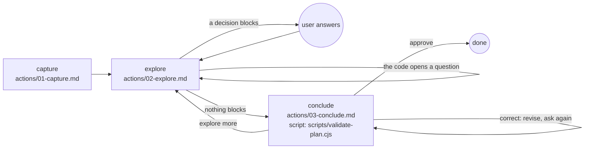

# Plan

## Actions

Each box is a file: read it, then do what it says.

## Transversal rules

- Speak only to ask or to give the final reply; otherwise call tools.
- Plan only: the plan files are the only files you write.
