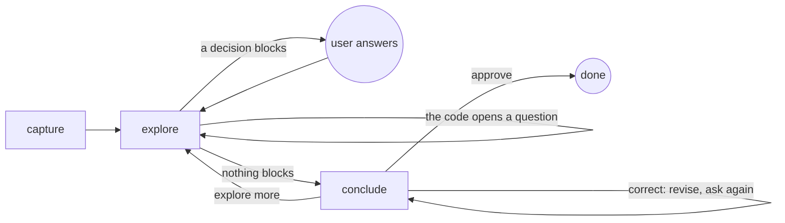

# Plan

## Actions

Read an action's file, then do what it says.

| Action | File |
| ------ | ---- |
| capture | [actions/01-capture.md](actions/01-capture.md) |
| explore | [actions/02-explore.md](actions/02-explore.md) |
| conclude | [actions/03-conclude.md](actions/03-conclude.md) |

## Transversal rules

- Speak only to ask or to give the final reply; otherwise call tools.
- Plan only: the plan files are the only files you write.
