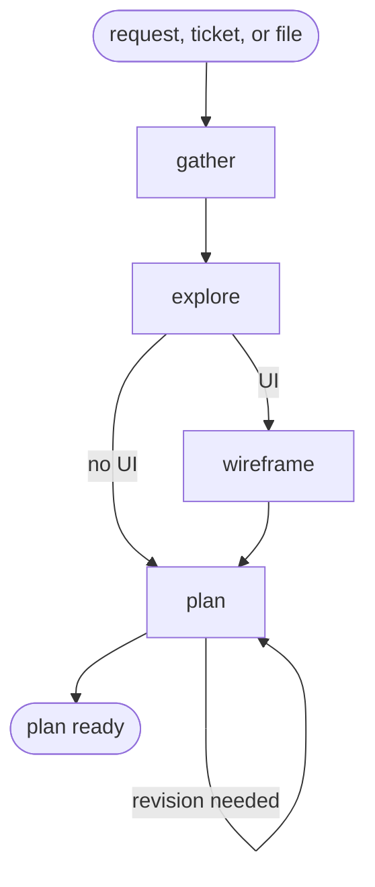

# Skill: plan



## Actions

Read only the next matching numbered action file in `actions/`.

| Action | Does |
| --- | --- |
| gather | collect and restate the source |
| explore | ground the projection, rules, and feasibility |
| wireframe | sketch frontend screens at low fidelity |
| plan | write and review the plan and phase files |

## Transversal rules

- Planning never writes application code.

Once the plan and its phase files are written, and only then, run:

```shell
echo "aidd:step-end aidd-dev:01-plan"
```

## References

- `references/wireframe-conventions.md`: how to draw the ASCII wireframe a screen needs.
- `references/plan-status.md`: the plan lifecycle `status` values and who writes each.

## Assets

- `assets/plan-template.md`: the `plan.md` scaffold.
- `assets/phase-template.md`: the per-phase scaffold.
