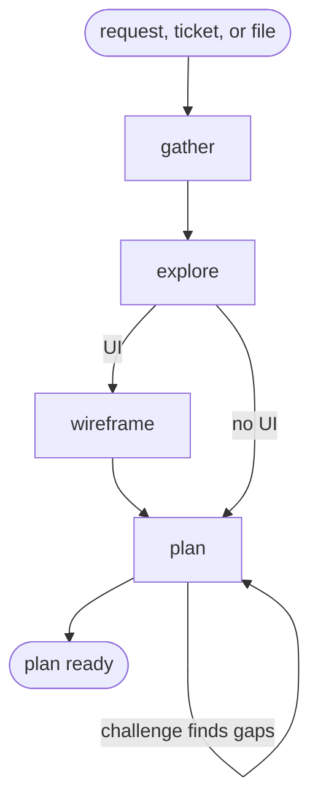

# Plan

## Actions

Read only the next numbered action file in `actions/`.

| Action | Does |
| --- | --- |
| gather | identify the source and constraints |
| explore | ground scope and feasibility in evidence |
| wireframe | sketch frontend screens |
| plan | write and challenge phases |

## Transversal rules

- **Read-only.** Never write application code.
