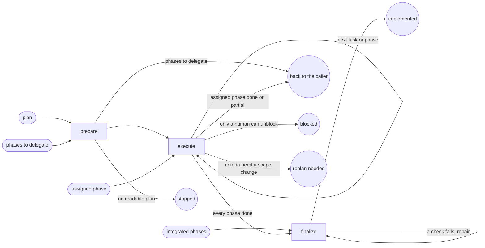

# Implement

## Actions

Read an action's file, then do what it says.

| Action | File |
| ------ | ---- |
| prepare | [actions/01-prepare.md](actions/01-prepare.md) |
| execute | [actions/02-execute.md](actions/02-execute.md) |
| finalize | [actions/03-finalize.md](actions/03-finalize.md) |

## Transversal rules

- Validate every acceptance criterion through the real affected workflow, with the interface it exposes (browser, CLI, API), checking actual against expected behavior at every step.
- Count a validation only after a full successful run with observable evidence for every step; a blocked validation is never a success.
- When only a human can unblock, follow [blocked.md](references/blocked.md) and leave unfinished code uncommitted.
- When the criteria require changing scope or requirements, stop with `replan needed: <reason>`; never rewrite the plan.
- Track the plan through `pending → in-progress → implemented`, or `blocked`, and a phase through `pending → in-progress → done`, or `partial`; a phase status lives in its `phase-<n>.md` when the plan has one.
- Never commit `in-progress` alone.
- Follow user and project commit instructions, and push only when asked.
- Commit each validated task with its code, tests and docs; group tasks only when they cannot be validated apart, never split one by step or file, and exclude unrelated changes.
- Include `done` in the phase's last task commit, and make a final commit for `implemented`.
- Format through the project's formatters or hooks, never by hand.
