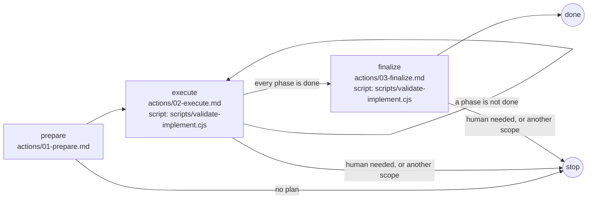

# Implement

## Actions

Read an action's file, then do what it says.

## Transversal rules

- Speak only to ask or to give the final reply; otherwise call tools.
- Code only: the plan is never rewritten.
- Push only when asked.
- Do what a hook asks; never bypass one.
