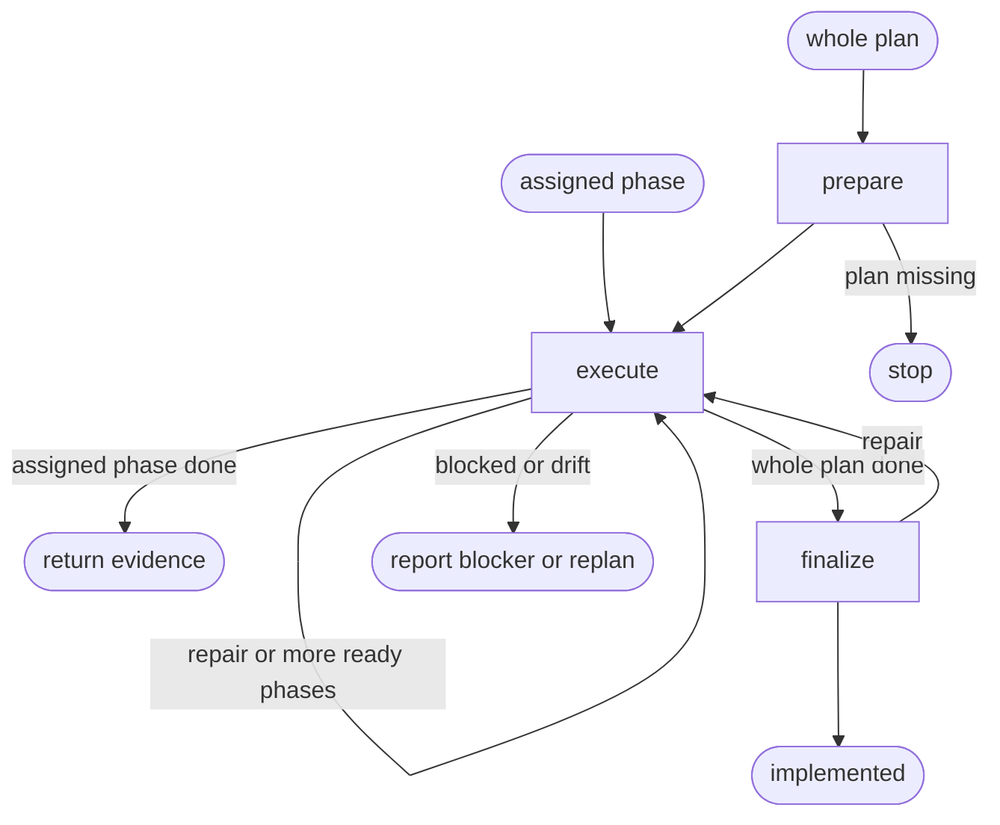

# Implement

## Actions

Read only the next numbered action file in `actions/`.

| Action | Does |
| --- | --- |
| prepare | resolve the plan and prepare its branch |
| execute | implement and check assigned scope |
| finalize | validate the integrated plan |

## Transversal rules

- **Ownership.** Whole-plan runners own integration and plan/phase lifecycle statuses; assigned-phase runners own only their phase status and skip prepare/finalize. Never change requirements or criteria; the caller retains final acceptance.
- **Commits.** Follow caller policy; when authorized, commit each phase's code with its `done` status and the final plan status separately, excluding unrelated changes. Runtime markers need no separate commit.
- **Delegation.** Only the primary caller may delegate; isolated agents never spawn agents.
