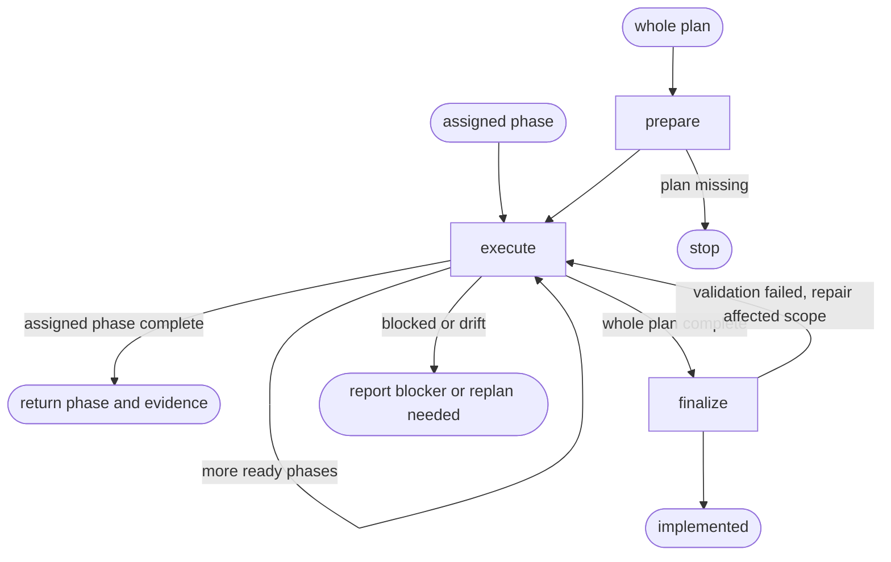

# Skill: implement

## Actions

Read only the next matching numbered action file in `actions/`.

| Action | Does |
| --- | --- |
| prepare | resolve the whole plan and prepare its branch |
| execute | implement and validate the selected scope |
| finalize | verify the integrated plan and mark it implemented |

## Transversal rules

- Supplying a whole plan assigns lifecycle-status ownership of that plan and its phases to the whole-plan runner. Supplying an assigned phase grants only that phase's lifecycle-status ownership. Neither grant permits changes to scope, specifications, or criteria.
- A whole-plan run owns integration and completion verification. An assigned-phase run enters execute directly and returns without prepare or finalize. The primary caller retains final acceptance.
- Phase status follows `pending → in-progress → done`. The whole-plan owner drives `pending → in-progress → implemented` or `blocked`. Runtime markers need no separate commit.
- Follow the caller's commit policy. When commits are authorized, commit each phase's code with its own `done` status and the final plan status separately. Keep unrelated changes out of these commits.
- Isolated agents never spawn agents. Only the primary caller may delegate bounded work using available host capabilities.

## References

- `references/blocked.md`: conditions requiring a human.
