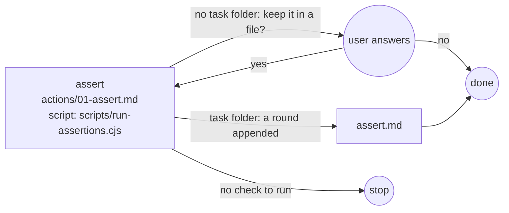

# Assert

## Actions

Each box is a file: read it, then do what it says.

## Transversal rules

- Speak only to ask or to give the final reply; otherwise call tools.
- The verdict is the script's first line, never your own reading.
- Change nothing but the report: no code, no test, no config.
- Do not commit or push.
