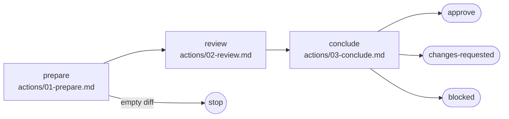

# Review

## Actions

Each box is a file: read it, then do what it says.

## Transversal rules

- Speak only to ask or to give the final reply; otherwise call tools.
- Read only: never run the app or its checks.
- Change nothing but the report: no code, no test, no config.
- Judge this work alone, never an earlier round.
