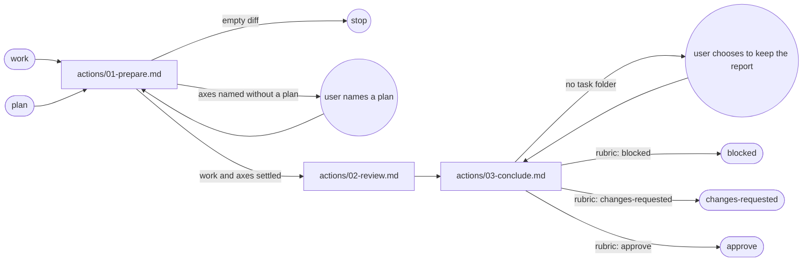

# Review

## Transversal rules

- Speak only to ask or to give the final reply; otherwise call tools.
- Read only: leave the app and its checks unrun, and change nothing but the report.
- Judge this work alone, and no earlier round.
