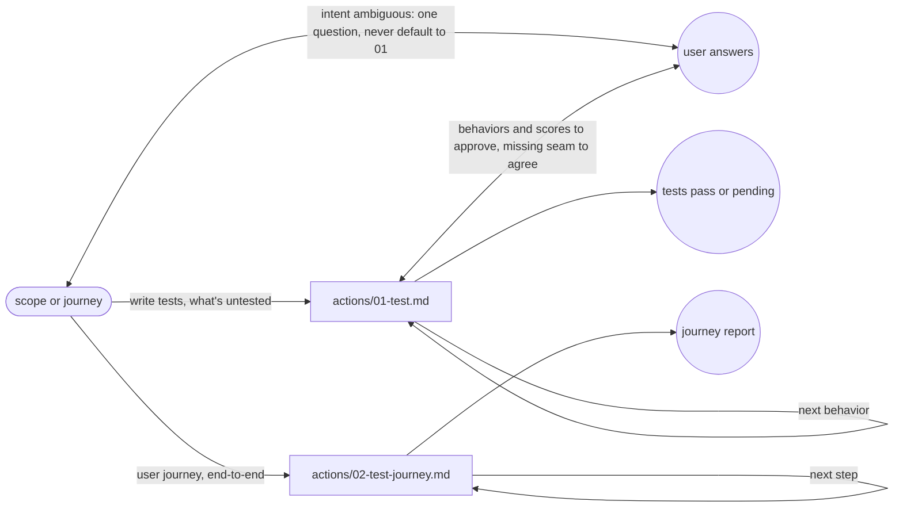

# Test

## Transversal rules
- One action per run: follow only the matching action file.
- Functional behavior only: never couple a test to implementation details.
- Never compromise quality for speed.
