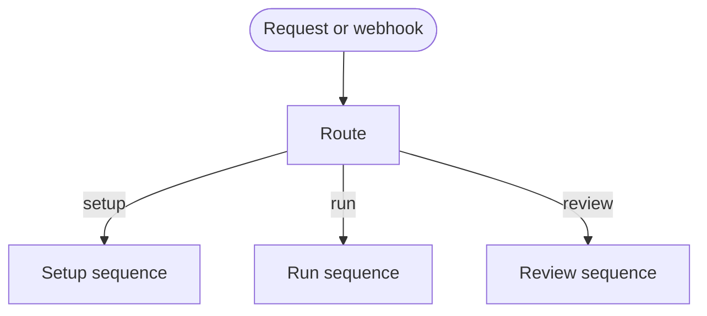

# Async-dev

## Actions

Run `route` first. Read only the selected mode action afterward.

| Action | Does |
| --- | --- |
| [`route`](actions/route.md) | Resolve the mode from arguments, trigger, repository state, and intent. |
| [`setup`](actions/setup.md) | Install and configure the async development pipeline. |
| [`run`](actions/run.md) | Process one ready issue through the discovered SDLC capability. |
| [`review`](actions/review.md) | Handle PR feedback until the stop condition or completion. |

## Transversal rules

- Exactly one mode runs per invocation. Once selected, complete that mode or surface its abort state; never reroute mid-flow.
- Mode actions own their preconditions, outputs, and postconditions. Route only selects a mode.
- For batches, the workflow invokes this skill once per item.
- Read a selected mode's action files in order; read its references and assets only when the action needs them.
