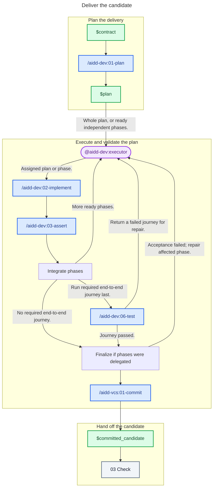

# 02 - Deliver

## Behavior

Turn the contract into a proportional plan, then give one executor the whole plan or delegate ready independent phases. For phase delegation, the caller owns preparation, dependencies, write isolation, integration, and finalization; give each executor its scope, criteria, checkout, validation resources, and commit policy. Integrate prerequisites before starting dependent phases.

The executor implements its scope and calls the validation skills, which own their checks and repair loops. Include architecture conformance whenever the project documents architecture. Run an end-to-end journey after every other validation when the plan calls for one, and none otherwise. Finalize delegated phases together after integration and required validation.

Commit and push the validated work through the commit skill. Send only the clean committed candidate and its evidence to Check.

