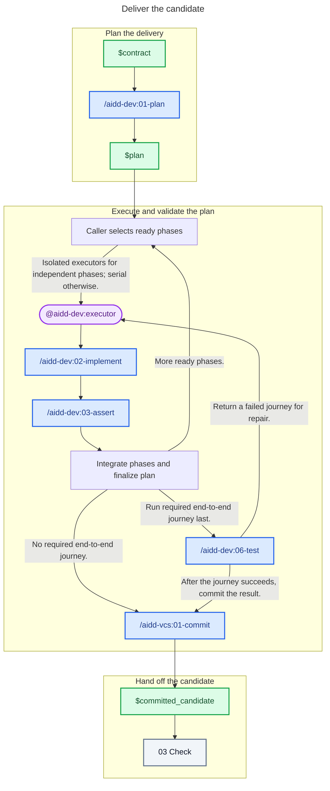

# 02 - Deliver

## Behavior

- **Plan:** reconcile scoped exploration, then produce the implementation plan.
- **Assign:** retain shared lifecycle and integration; delegate independent phases with their criteria, prerequisites, status-file ownership, checkout, resources, and commit policy. Use separate checkouts for parallel writers; otherwise run serially. A whole-plan executor may own all lifecycle statuses, never scope or criteria.
- **Integrate:** accept scoped changes and evidence before starting dependents; finalize against the combined candidate, with required end-to-end checks last. Reuse only evidence still valid for that candidate and scope.
- **Handoff:** commit and push through the commit capability; send the clean candidate and evidence to Check.

