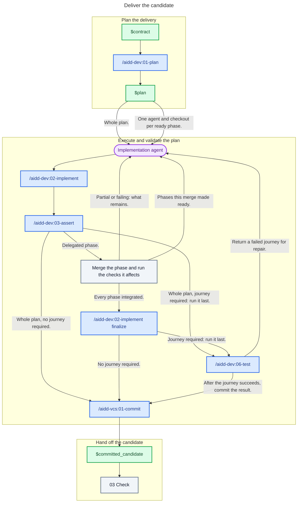

# 02 - Deliver

## Behavior

Turn the contract into a proportional plan, then give one implementation agent the whole plan. When phases have their dependencies met and touch separate files, delegate them instead: prepare the plan through the implementation skill, give each ready phase its own agent and checkout with its phase file as the brief, merge each returned phase and run the checks it affects, and repeat for the phases a merge made ready. A `partial` or failing phase goes back to an agent with what remains. Once every phase is integrated, finalize the plan through the implementation skill.

The caller owns delegation, integration, plan status, and final acceptance; the validation skills own their checks and repair loops. Include architecture conformance whenever the project documents architecture. Run an end-to-end journey after every other validation when the plan calls for one, and none otherwise.

Send only the clean committed candidate to Check.

