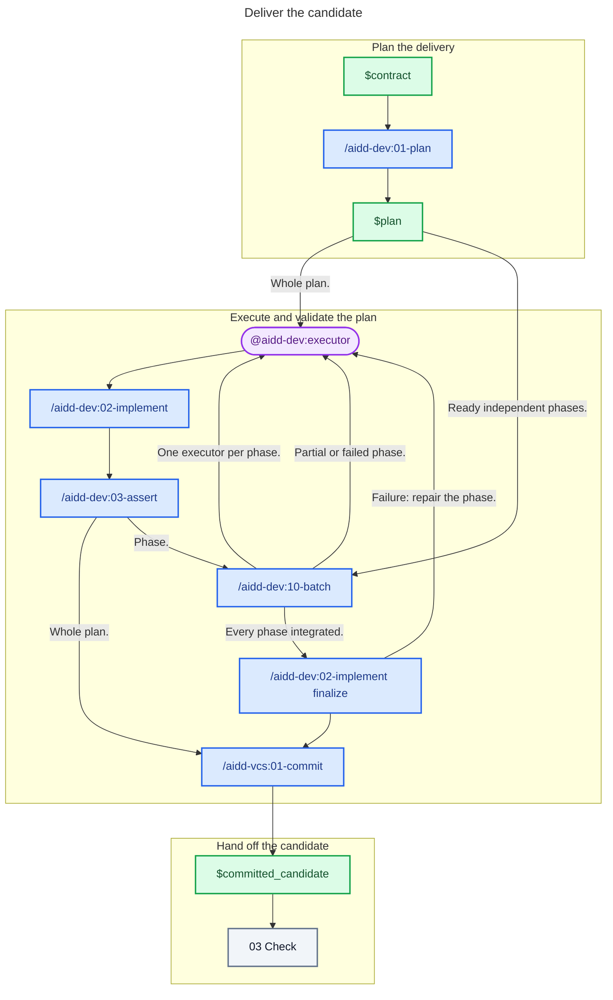

# 02 - Deliver

## Behavior

Turn the contract into a proportional plan, then give one executor the whole plan. When the plan has ready independent phases, delegate them instead: prepare the plan through the implementation skill, dispatch the ready phases through the batch skill, one executor per phase with its phase file as the brief, and finalize the integrated plan through the implementation skill. A `partial` or failed phase goes back to an executor with what remains.

The caller owns delegation, integration, plan status, and final acceptance; the validation skills own their checks and repair loops. Include architecture conformance whenever the project documents architecture.

Send only the clean committed candidate and its evidence to Check.

