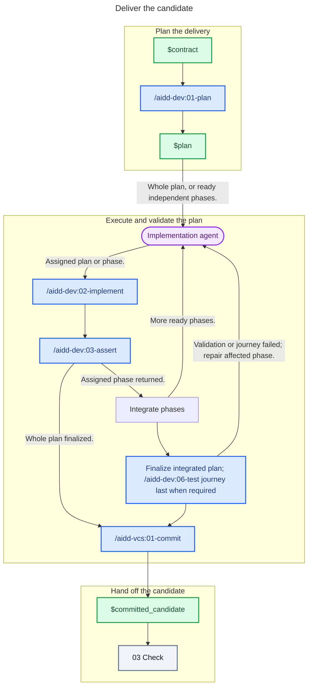

# 02 - Deliver

## Behavior

Turn the contract into a proportional plan, then give one executor the whole plan or delegate ready independent phases. For delegated phases, the caller owns preparation, dependencies, write isolation, integration, and finalization; give each executor its checkout and its phase file, and nothing the phase file already says. Resume the same executor session for its next phase, and leave its checkout untouched while it runs. Integrate prerequisites before starting dependent phases.

The executor follows the implementation skill for its assigned scope and calls the validation skills, which own their checks and repair loops. Include architecture conformance whenever the project documents architecture. Whole-plan execution keeps its normal flow; phase executors return for integration. Finalize the integrated plan once, including any required end-to-end journey after other checks and before marking it implemented.

Commit and push the validated work through the commit skill. Send only the clean committed candidate and its evidence to Check.

