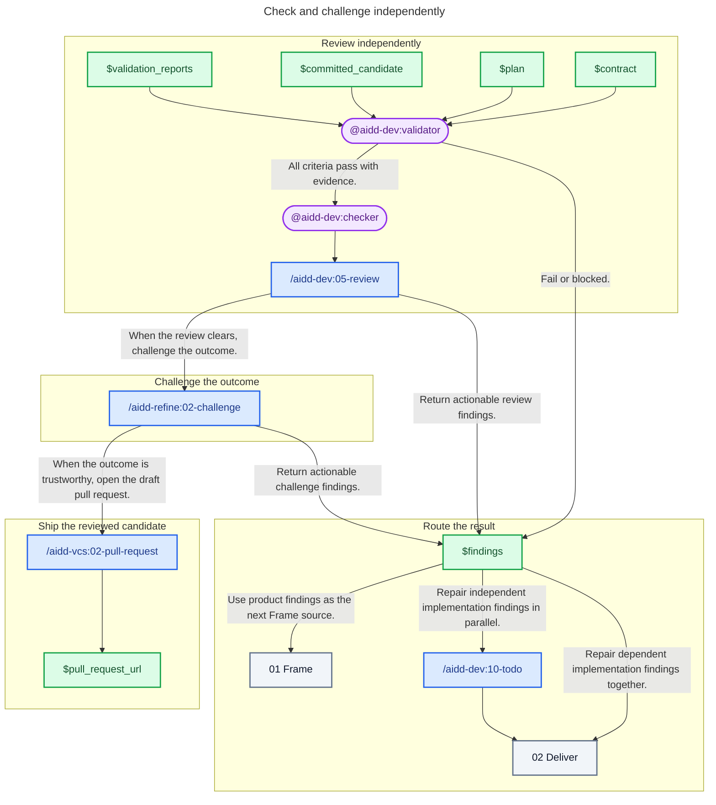

# 03 - Check

## Behavior

- **Validate:** dispatch a fresh validator on the committed candidate, contract, criteria, and mandatory checks.
- **Challenge:** after validation passes, dispatch a fresh checker for review and outcome challenge using that evidence.
- **Route:** send product findings to Frame, independent repairs to Todo, dependent repairs to Deliver; revalidate each repaired candidate.
- **Ship:** open the draft pull request when no actionable finding remains.

