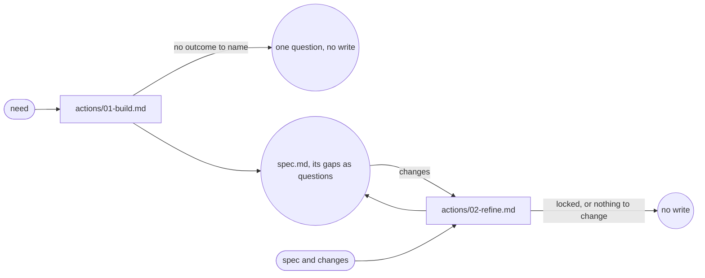

# Spec

## Transversal rules

- Never explore the codebase.
- End with at most three open gaps as questions, those that would change the target most.
- Never rewrite a spec whose status is `locked`, nor change or offer to change that status: only the person who approves it does.
