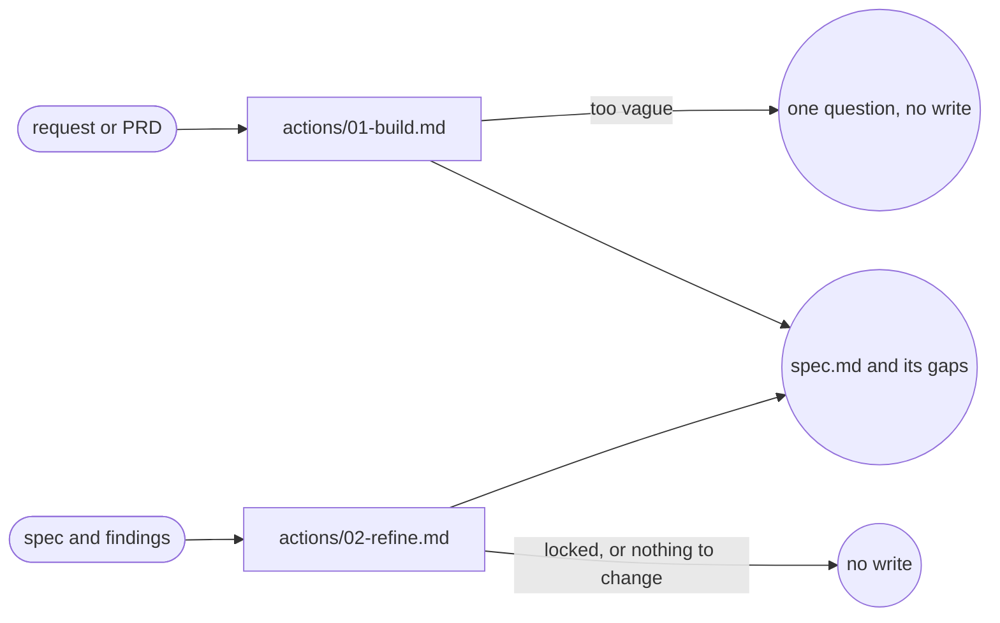

# Spec

## Transversal rules

- Never invent: mark each gap instead of guessing.
- Never explore the codebase.
- Hold intent, never implementation: no library, framework pattern or file layout.
- Never rewrite a spec whose status is `locked`, a status only the person who approves it sets.
