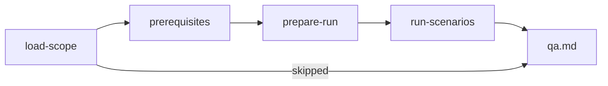

# Acceptance QA

## Actions

Read only the next action's file before running it.

| Action | Does |
| --- | --- |
| load-scope | lock one happy path per journey and the edge cases its criteria name |
| prerequisites | verify the browser runner |
| prepare-run | resolve the shortest deterministic path to executable runs |
| run-scenarios | run, verdict, reset and report every scenario |

## Transversal rules

- Run against a reviewed change and never patch the application.
- Invoked by another skill or agent, never ask: return `blocked` with the question.
- Every run ends with `qa.md`, a blocked one included.
- Never derive a scenario from the diff or the source code; every scenario traces to an acceptance criterion.
- Never spawn agents. Batch independent reads and tool checks, but keep state-changing browser work sequential.
- Do not narrate action transitions, searches, fixtures, selectors, or successful checks. Report only a blocker, a required decision, or the final verdict and paths.
