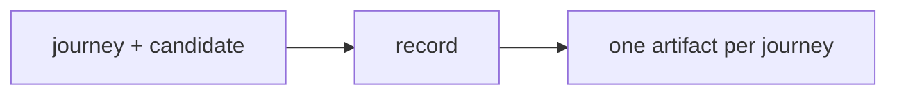

# Demo

## Actions

Read only the action's file before running it.

| Action | Does |
| --- | --- |
| record | record, validate and label one artifact per journey |

## Transversal rules

- Run against a candidate and never patch the application.
- Never delete data not proven test-only.
- Never invent a step or an expected outcome; both come from the journey.
- Invoked by another skill or agent, never ask: return `blocked` with the question.
- Never spawn agents. Keep state-changing work sequential.
- Do not narrate. Report only a blocker, a required decision, or the final paths and labels.
