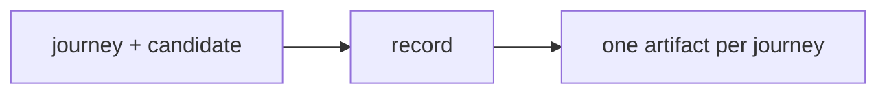

# Demo

## Actions

Read only the action before running it.

| Action | Does |
| --- | --- |
| record | record, validate and label each journey |

## Transversal rules

- Run against the candidate; never patch it, delete data not proven test-only, or invent steps or expected outcomes.
- Invoked by another skill or agent, never ask: return `blocked` with the question.
- Never spawn agents; sequence state changes.
- Report only blockers, required decisions, final paths and labels.
