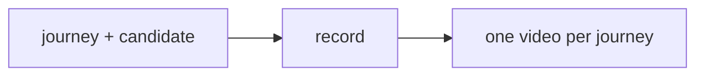

# Demo

## Actions

Read only the next action's file before running it.

| #   | Action   | Does                                                      |
| --- | -------- | --------------------------------------------------------- |
| 01  | `record` | Record, normalize, validate, and label one video per journey |

## Transversal rules

- Run against a candidate and never patch the application.
- Never delete data not proven test-only.
- Never invent a step or an expected outcome; both come from the journey.
- Never decide where a video goes; the caller does.
- Never spawn agents. Keep state-changing browser work sequential.
- Do not narrate transitions or successful checks. Report only a blocker, a required decision, or the final paths.
