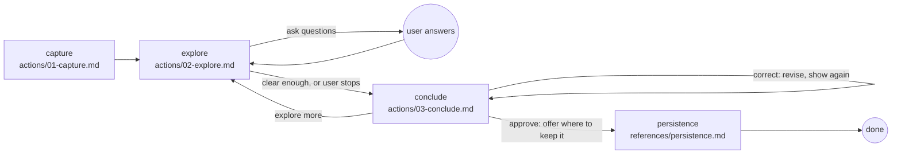

# Brainstorm

## Actions

Each box is a file: read it, then do what it says.

## Transversal rules

- Clarify only: never plan or code.
- Ask a question only if its answer changes the outcome.
- Talk about the idea, never the skill's steps or files.
- After questions, approval or persistence options, wait.
- When the user wants to stop or asks for a summary, go to conclude and produce the brief in the chat.
