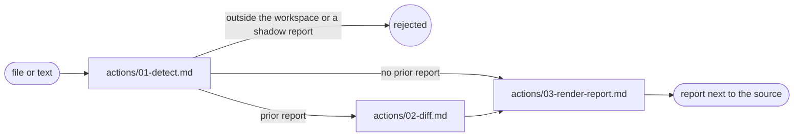

# Shadow Areas

## Transversal rules

- Never modify the source artifact.
- A gap is identified by its category and snippet, else by its category and severity, never by its question's wording.
- The report sits next to its source, named by dropping the source's last extension and appending `-shadow-report.md`: `feature-v2.draft.md` gives `feature-v2.draft-shadow-report.md`, `Makefile` gives `Makefile-shadow-report.md`.
