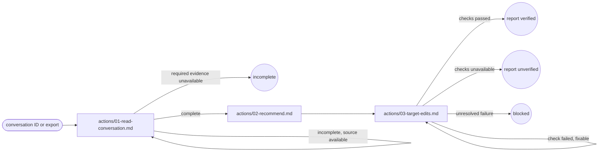

# Review conversation

## Transversal rules

- **Scope:** access only the selected conversation tree and its relevant sources.
- **Evidence:** use recorded facts and cite the session and message sequence for every finding.
- **Uncertainty:** mark unavailable measurements and unproven causes explicitly.
- **Writes:** keep project files read-only and write only inside one unique temporary run directory.
