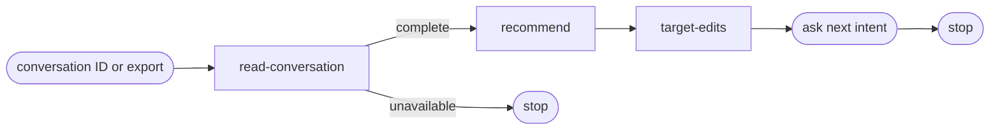

# Review conversation

## Actions

Run all three actions in order without confirmation. Read only the next file in `actions/`.

| Order | Action |
| --- | --- |
| 1 | `01-read-conversation.md` |
| 2 | `02-recommend.md` |
| 3 | `03-target-edits.md` |

## Transversal rules

- Access only the selected conversation tree and its relevant sources.
- Use recorded evidence only; every finding cites a message sequence. Mark unavailable measurements as such.
- Keep project files read-only; write only a unique temporary report.
