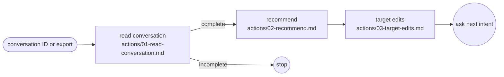

# Review conversation

## Actions

Each box is a file: read it, then do what it says, without confirmation.

## Transversal rules

- Access only the selected conversation tree and its relevant sources.
- Use recorded evidence only; every finding cites a message sequence. Mark unavailable measurements as such.
- Keep project files read-only; write only inside one unique temporary run directory.
