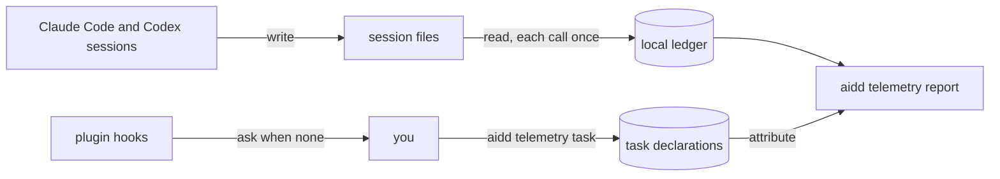

← [aidd-framework](../../README.md)

# aidd-telemetry

Counts the tokens your Claude Code and Codex sessions consume.

| | |
| --- | --- |
| Status | beta |
| Install | `aidd plugin install aidd-telemetry` |
| Start with | `aidd telemetry on` |
| Details | [Usage contract](../../aidd_docs/product/usage-contract.md) |

## How it works

## Start

1. `npm install -g @ai-driven-dev/cli`
2. `aidd plugin install aidd-telemetry` (its hooks need `node` on `PATH`)
3. `aidd telemetry on`, in each clone to measure
4. `aidd telemetry task <name> [--ticket <ref>]`, when asked
5. `aidd telemetry report --axis task`

Codex: trust the plugin's hooks once, with `/hooks` in the TUI.

## Commands

| Command | Does |
| --- | --- |
| `aidd telemetry on` / `off` | Start or stop measuring this clone |
| `aidd telemetry status` | Show if this clone is measured, and its task |
| `aidd telemetry task <name>` | Declare the task (`--ticket <ref>`, or `--none`) |
| `aidd telemetry report` | Show what the work consumed, along one axis (`--axis`, `--days`, `--task`, `--json`) |
| `aidd telemetry identity <id>` | Be named on your own measurement (`--off` to stop) |
| `aidd telemetry forget` | Show what is kept (`--yes` erases it) |

## Rules

- Only clones that ran `on` are measured, from then on.
- A task and a ticket come only from what you declare.
- Each model call counts once, whatever the axis.
- Where you are asked for a task, and the limits: [usage contract](../../aidd_docs/product/usage-contract.md).

## Privacy

- Nothing leaves your machine.
- Consent is per clone and never committed.
- Data lives in `~/.config/aidd/telemetry` and the clone's git config.
- You are named only if you choose to be.
- `AIDD_TELEMETRY=0` refuses measurement everywhere.

## Skills

| Skill | Use it to |
| --- | --- |
| `aidd-telemetry:00-init` | Opt in, stop, set or remove your identity, forget |
| `aidd-telemetry:01-usage` | Ask what a period, a task or a ticket consumed |
