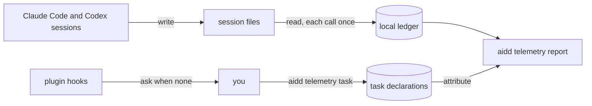

← [aidd-framework](../../README.md)

# aidd-telemetry

Counts the tokens your Claude Code and Codex sessions consume.

| | |
| --- | --- |
| Status | beta |
| Install | `aidd plugin install aidd-telemetry` |
| Start with | `aidd telemetry on` |
| Skills | [Catalog](../../docs/CATALOG.md#-aidd-telemetry) |
| Details | [Usage contract](../../aidd_docs/product/usage-contract.md) |

## How it works

## Start

1. `npm install -g @ai-driven-dev/cli`
2. `aidd plugin install aidd-telemetry` (its hooks need `node` on `PATH`)
3. `aidd telemetry on`, in each clone to measure
4. `aidd telemetry task <name> [--ticket <ref>]`, when asked
5. `aidd telemetry report --axis task`

Codex: trust the plugin's hooks once, with `/hooks` in the TUI.

## Commands

[CLI reference](../../cli/README.md#measurement).

## Rules

- Only clones that ran `on` are measured, from then on.
- A task and a ticket come only from what you declare.
- Each model call counts once, whatever the axis.
- Where you are asked for a task, and the limits: see the usage contract.

## Local usage measurement privacy

- Nothing leaves your machine.
- Consent is per clone and never committed.
- Data lives in `~/.config/aidd/telemetry` and the clone's git config.
- You are named only if you choose to be.
- `AIDD_TELEMETRY=0` refuses AIDD usage measurement everywhere.

## Provider OpenTelemetry

Configure an exporter with `aidd telemetry otel init --config=<claude|codex|opencode> --endpoint=dev`, follow its launch instructions, then run `aidd telemetry otel verify` with the same options after a test session. The collector must already be running. See the [setup recipe](../../aidd_docs/recipes/observe-agent-telemetry.md) for destination requirements and verification limits.
