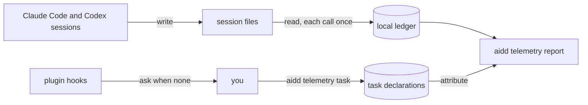

← [aidd-framework](../../README.md)

# aidd-telemetry

Measures Claude Code and Codex usage locally, and can configure provider OpenTelemetry export.

| | |
| --- | --- |
| Status | beta |
| Install | `aidd plugin install aidd-telemetry` |
| Start with | `aidd telemetry on` |
| Skills | [Catalog](../../docs/CATALOG.md#-aidd-telemetry) |
| Details | [Usage contract](../../aidd_docs/product/usage-contract.md) |

## How it works

The local ledger and provider OTLP captures are separate sources. The OTLP sync reuses the ledger's session attribution, task declarations and consent history; it does not replace the local report. Do not add their totals together.

## Choose a mode

| Mode | Opt-in and destination | Identity | What is kept or sent |
| --- | --- | --- | --- |
| Local usage | `aidd telemetry on` explicitly enables measurement for the current clone from that time. The ledger and report stay on this machine. | An optional name labels the local report; anonymous use is supported. | Per-call usage read from Claude Code and Codex session files: session, time, model, agent, token counts and local attribution context. The ledger does not store prompts or responses. |
| OTLP development | Explicitly configure each provider with `otel init --endpoint=dev` and start the local collector. A separate `otel sync` sends supported data only to loopback Gouvernail for sessions covered by the clone's consent. | No local report name is required. Native provider identifiers may still be sent when present; attribution in Gouvernail needs a matched active member. The connector token is not a person identity. | The collector stores raw provider events, which may include prompts, responses, commands and tool output. The sync excludes fields for those contents and traces, but does not inspect allowed attribute values for secrets. See [exact fields](OBSERVABILITY.md#what-sync-sends). |
| OTLP production | **Not available:** `--endpoint=prod` is refused. `https://gouvernail.eu` is an intended future destination, not an active exporter. | **Required before production is enabled:** an authenticated user identity. This is a product requirement, not yet implemented or enforced. | No production payload is sent by this feature today. Consent, authentication, retention and deletion behavior must be implemented before enabling it. |

### Consent and scope

- `on` is an explicit opt-in for one clone, not a team-wide setting. The local ledger and OTLP sync use its consent intervals; an earlier consent does not cover later work after `off`.
- `otel init` is a separate, explicit action to configure a provider's user-level exporter. The CLI does not show a separate consent dialog or record separate OTLP consent; the init skill asks for authorization before running it. When that provider and the collector are running, raw OTLP may be captured from other projects too: **the collector does not check clone consent**. The sync checks consent before forwarding.
- `aidd telemetry off` stops local measurement for the current clone; it does **not** disable provider exporters or stop the OTLP collector. A process started with `AIDD_TELEMETRY=0` refuses local measurement and sync, not raw collection; changing an environment variable does not change an already running process.
- `aidd telemetry forget` previews or deletes local usage measurement. It does **not** delete OTLP capture files, sync state, or data already received by Gouvernail. Production deletion is not available; the requested production policy is to disallow it.
- Raw captures are private local files, but have no automatic retention limit. They can contain sensitive content. The local collector and sync processes do not restart automatically.

### Three different identifiers

| Identifier | Purpose and storage | Sent to Gouvernail? |
| --- | --- | --- |
| Local report name | Optional label in `~/.config/aidd/telemetry/identity.json`; the current label is applied when reporting, not recorded as proof per call. | No. |
| Installation UUID | Stable ID in `~/.config/aidd/installation/id.json`; not a login or credential. | Not currently. |
| Provider identity | Native email, account or organization ID when emitted. Gouvernail must match an approved active member to attribute a session. | The allowlisted identifiers may be sent by the dev sync. |

The default paths can change with the configured user directory. A connector bearer token authorizes the destination connection; it does not identify the person.

## Start

1. `npm install -g @ai-driven-dev/cli`
2. `aidd plugin install aidd-telemetry` (its hooks need `node` on `PATH`)
3. `aidd telemetry on`, in each clone to measure
4. `aidd telemetry task <name> [--ticket <ref>]`, when asked
5. `aidd telemetry report --axis task`

Codex: trust the plugin's hooks once, with `/hooks` in the TUI.

## Commands

[CLI reference](../../cli/README.md#measurement).

## Rules

- Only clones that ran `on` are measured, from then on.
- A task and a ticket come only from what you declare.
- Each model call counts once, whatever the axis.
- Where you are asked for a task, and the limits: see the usage contract.

## Local usage measurement privacy

- This local usage ledger and its reports stay on your machine. Provider OTLP export is a separate opt-in described above.
- Consent is per clone and never committed.
- Data lives in `~/.config/aidd/telemetry` and the clone's git config.
- You are named only if you choose to be.
- `AIDD_TELEMETRY=0` refuses AIDD usage measurement everywhere.
- Framework setup creates a stable installation UUID at `~/.config/aidd/installation/id.json` (or under the configured user directory), independently of the optional person label. It is not a credential or a login; telemetry setup creates it for older installations. It is retained when telemetry is forgotten. It is not yet attached to usage records or linked to an account.

## Provider OpenTelemetry

Configure an exporter with `aidd telemetry otel init --config=<claude|codex|opencode> --endpoint=dev`, follow its launch instructions, then run `aidd telemetry otel verify` with the same options after a test session. The collector must already be running. See the [setup recipe](../../aidd_docs/recipes/observe-agent-telemetry.md) for destination requirements and verification limits, and the [provider field mapping](OBSERVABILITY.md) for available signals and their limits. OpenCode v1/v2 capture support does not yet imply OpenCode-to-Gouvernail sync.

Start OpenCode v1 with `aidd telemetry otel run --config=opencode` to supply its endpoint and token; pass OpenCode arguments after `--`. For OpenCode v2, restart its service after initialization.
