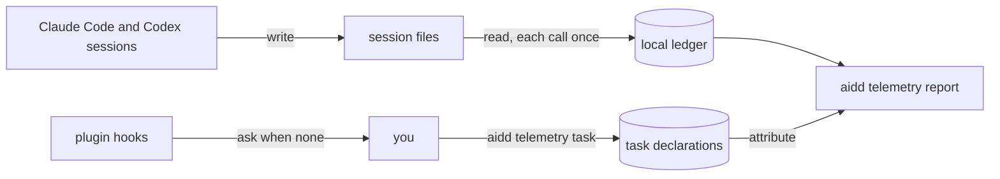

← [aidd-framework](../../README.md)

# aidd-telemetry

Measures Claude Code and Codex usage locally, and can configure provider OpenTelemetry export.

| | |
| --- | --- |
| Status | beta |
| Install | `aidd plugin install aidd-telemetry` |
| Start with | `aidd telemetry on` |
| Skills | [Catalog](../../docs/CATALOG.md#-aidd-telemetry) |
| Details | [Usage contract](../../aidd_docs/product/usage-contract.md) |

## How it works

The Gouvernail AI KPI view uses provider OpenTelemetry (OTel) signals only. The framework's local ledger powers `aidd telemetry report` and remains separate. Do not add their totals: both sources can cover the same calls. See the [field inventory](OBSERVABILITY.md).

## Choose a mode

| Mode | Opt-in and destination | Identity | What is kept or sent |
| --- | --- | --- | --- |
| Local usage | `aidd telemetry on` explicitly enables measurement for the current clone from that time. The ledger and report stay on this machine. | An optional name labels the local report; anonymous use is supported. | Per-call usage read from Claude Code and Codex session files: session, time, model, agent, token counts and local attribution context. The ledger does not store prompts or responses. |
| OTLP development | `otel run --yes` explicitly opts in one isolated execution and sends supported observations to loopback Gouvernail. | Provider identifiers may be sent when present; attribution requires a matched active member. The connector token is not a person identity. | With `--keep-capture`, the private capture can contain prompts, responses, commands and tool output. Forwarding filters fields but does not inspect allowed attribute values for secrets. See the [field inventory](OBSERVABILITY.md). |
| OTLP production | **Not available:** `--endpoint=prod` is refused. `https://gouvernail.eu` is an intended future destination, not an active exporter. | **Required before production is enabled:** an authenticated user identity. This is a product requirement, not yet implemented or enforced. | No production payload is sent by this feature today. Consent, authentication, retention and deletion behavior must be implemented before enabling it. |

### Consent and scope

- `on` opts in the separate local usage ledger for one clone. `otel run --yes` opts in the single provider execution independently; it does not attribute observations to a clone or feature.
- `otel init` separately configures a user-level exporter. Its global collector can capture other projects and does not check clone consent. It is not required for `otel run`.
- `aidd telemetry off` and `forget` affect local usage measurement; they do not disable provider exporters or delete retained OTLP captures or data already received by Gouvernail.
- Retained captures are private local files without automatic deletion. They can contain sensitive content. Claude metric forwarding also sends a deterministic series fingerprint, which can expose equality or allow guesses of low-entropy values.
- Delivery after a timeout cannot guarantee exactly-once behavior without receiver-side idempotence.

### Three different identifiers

| Identifier | Purpose and storage | Sent to Gouvernail? |
| --- | --- | --- |
| Local report name | Optional label in `~/.config/aidd/telemetry/identity.json`; the current label is applied when reporting, not recorded as proof per call. | No. |
| Installation UUID | Stable ID in `~/.config/aidd/installation/id.json`; not a login or credential. | Not currently. |
| Provider identity | Email, account or organization ID when emitted. Gouvernail must match an approved active member to attribute a session. | Allowlisted identifiers may be sent by `otel run`. |

The default paths can change with the configured user directory. A connector bearer token authorizes the destination connection; it does not identify the person.

## Start

1. `npm install -g @ai-driven-dev/cli`
2. `aidd plugin install aidd-telemetry` (its hooks need `node` on `PATH`)
3. `aidd telemetry on`, in each clone to measure
4. `aidd telemetry task <name> [--ticket <ref>]`, when asked
5. `aidd telemetry report --axis task`

Codex: trust the plugin's hooks once, with `/hooks` in the TUI.

## Commands

[CLI reference](../../cli/README.md#measurement).

## Rules

- Only clones that ran `on` are measured, from then on.
- A task and a ticket come only from what you declare.
- Each model call counts once, whatever the axis.
- If an origin change is observed in the same clone, usage before its detection keeps its tokens but loses repository and task attribution. Changes made and reversed between observations, or changes overwritten before this protection existed, cannot be detected retrospectively.
- Repository attribution is unavailable for usage older than the first recorded observation of its clone. If the local resolution history is lost, attribution remains unavailable for earlier usage.
- A directory that is no longer available cannot establish its current origin, so its usage keeps its tokens without repository or task attribution.
- Where you are asked for a task, and the limits: see the usage contract.

## Local usage measurement privacy

- This local usage ledger and its reports stay on your machine. Provider OTLP export is a separate opt-in described above.
- Consent is per clone and never committed.
- Data lives in `~/.config/aidd/telemetry` and the clone's git config.
- You are named only if you choose to be.
- `AIDD_TELEMETRY=0` refuses AIDD usage measurement everywhere.
- Framework setup creates a stable installation UUID at `~/.config/aidd/installation/id.json` (or under the configured user directory), independently of the optional person label. It is not a credential or a login; telemetry setup creates it for older installations. It is retained when telemetry is forgotten. It is not yet attached to usage records or linked to an account.

## Provider OpenTelemetry

Configure an exporter with `aidd telemetry otel init --config=<claude|codex|opencode> --endpoint=dev`, follow its launch instructions, then run `aidd telemetry otel verify` with the same options after a test session. The collector must already be running. See the [setup recipe](../../aidd_docs/recipes/observe-agent-telemetry.md) for destination requirements and verification limits, and the [provider field mapping](OBSERVABILITY.md) for available signals and their limits.

OpenCode initialization installs an opt-in server plugin. It sends session and event IDs, selected model and variant, optional OpenCode project and parent IDs, and positive OpenCode-normalized token counts to the configured local collector. It does not send prompts, responses, tool contents or cost. A missing or zero counter remains unavailable; delivery is not guaranteed. Restart the OpenCode v2 service after initialization. The one-execution `otel run --yes` enables this plugin for that run; it does not require global initialization.
