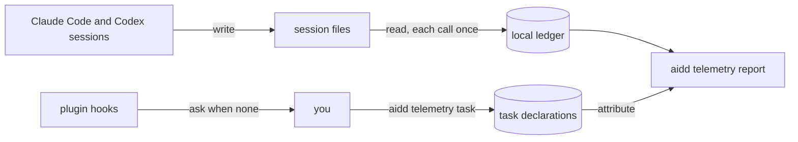

← [aidd-framework](../../README.md)

# aidd-telemetry

Counts the tokens your Claude Code and Codex sessions consume.

| | |
| --- | --- |
| Status | beta |
| For | People who measure their work |
| Install | `aidd plugin install aidd-telemetry` |
| Start with | `aidd telemetry on` |
| Formats, rules and limits | [Usage contract](../../aidd_docs/product/usage-contract.md) |

Each model call is counted once.
It is split by person, session, model, agent, tool, day, repository, task and ticket.
Everything stays on your machine: nothing is sent anywhere.

## How it works

- Only clones that ran `aidd telemetry on` are measured, from that moment on.
- A task and a ticket come only from what you declare. Nothing is guessed.
- Every axis splits the same total.
- Codex is read from `CODEX_HOME` or `~/.codex`.
- It is read whenever `aidd telemetry ingest` or `report` runs, and at a trusted Codex session start.

## Start

1. Install the CLI: `npm install -g @ai-driven-dev/cli`.
2. Install the plugin: `aidd plugin install aidd-telemetry`. Its hooks need `node` on `PATH`.
3. In each clone to measure: `aidd telemetry on`.
4. Declare the task of the branch: `aidd telemetry task <name> [--ticket <ref>]`.
5. Read: `aidd telemetry report --axis task`.

| Topic | Detail |
| --- | --- |
| Identity | With none set, `on` asks how you appear: your git name, another identifier, or anonymous |
| Without a terminal | `--yes --as <id>` or `--yes --anonymous` |
| Codex | Trust the plugin's hooks once with `/hooks` in the TUI. Codex runs no hook it was not told to trust, and asks again when an update changes a hook's entry |
| Codex desktop app | No review of its own: it runs the hooks once they are trusted from the TUI |
| No task yet | Claude Code and the Codex TUI hold each prompt and ask for one. Send `aidd telemetry task <name> [--ticket <ref>]` (or `--none`) as your next prompt, or run it in a terminal |
| Declared | The branch is never asked again, unless a copy or rename onto it changes its keys |
| Copied branch | A declaration belongs to its branch. A branch copied or renamed with `git branch -c` or `-m` is asked again, unless the declaration was written by cli-v5.5.0 or earlier ([usage contract](../../aidd_docs/product/usage-contract.md), limits) |

## Where you are asked

| Surface | Asked |
| --- | --- |
| Claude Code, terminal and desktop app | yes |
| Claude Code, an IDE extension or the SDK | no |
| Codex TUI | yes, unless in full-access mode (approval `never`) |
| `codex exec`, and the Codex IDE extension and desktop app on their own threads (`originator` is not `codex-tui`) | no |
| A Codex TUI thread resumed in the desktop app or the IDE extension | yes, unless approvals are off there (inferred: a resume keeps the thread's first line). The desktop app shows a block's reason. The IDE extension was not observed |

- Where nobody is asked, a call takes its task from its branch's declaration.
- There, declare the branch with `aidd telemetry task` in a terminal.
- A Codex `/clear` or fork starts a new session, asked again on an undeclared branch.
- Claude Code keeps the task across both.
- The usage contract lists the rest.

## Commands

| Command | Does |
| --- | --- |
| `aidd telemetry on` / `off` | Start or stop measuring this clone. What was measured stays |
| `aidd telemetry on --as <id>` | Name you |
| `aidd telemetry on --anonymous` | Name nobody |
| `aidd telemetry status` | Show if this clone is measured, since when, its task, and under which name |
| `aidd telemetry task <name> [--ticket <ref>]` | Declare the task (`--none` for no task) |
| `aidd telemetry report [--axis <axis>] [--days <n>] [--task <name>]` | Show what the work consumed, split along one axis. Narrow it with `--task`, `--ticket`, `--repository .` and the other filters of `--help`. `--json` prints the envelope |
| `aidd telemetry identity <id>` / `--off` | Be named on your own measurement, or not |
| `aidd telemetry forget` / `--yes` | Show what is kept, then erase it |

## Skills

| Skill | Use it to |
| --- | --- |
| `aidd-telemetry:00-init` | Opt in, stop, set or remove your identity, forget |
| `aidd-telemetry:01-usage` | Ask what a period, a task or a ticket consumed |

## Privacy

- Consent is per clone and never committed. A teammate who pulls is not measured until they run `on`.
- Data stays in `~/.config/aidd/telemetry` and the clone's git config. `forget --yes` erases it.
- You are named only by choosing to be, at `on` or with `identity`.
- Otherwise the person axis reads `anonymous`. That choice is not stored: the next `on` asks again.
- `AIDD_TELEMETRY=0` refuses measurement everywhere.
