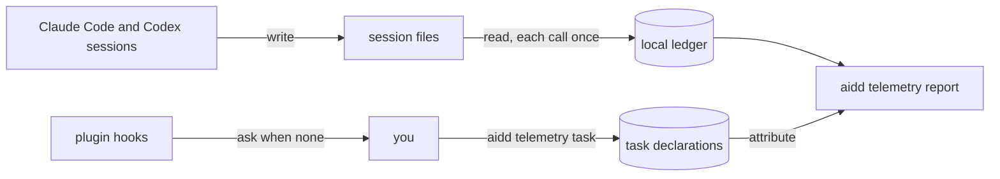

← [aidd-framework](../../README.md)

# aidd-telemetry

Counts the tokens your Claude Code and Codex sessions consume, each model call once, by person, session, model, agent, day, repository, task and ticket. Local only: nothing is sent anywhere.

> For: people who measure their work. Formats, rules and limits: [usage contract](../../aidd_docs/product/usage-contract.md).

## How it works

- Only clones that ran `aidd telemetry on` are measured, from that moment on.
- A task and a ticket come only from what you declare; nothing is guessed.
- Every axis splits the same total.
- Codex is read with the rest, from `CODEX_HOME` or `~/.codex`, whenever `aidd telemetry ingest` or `report` runs. The plugin's hooks run in Claude Code, so nothing asks a Codex session for its task: a Codex call takes it from its branch's declaration only.

## Start

1. Install: `npm install -g @ai-driven-dev/cli`, then `aidd plugin install aidd-telemetry`. Its hooks need `node` on `PATH`.
2. In each clone to measure: `aidd telemetry on`. With no identity set, it asks how you appear: your git name, another identifier, or anonymous. Without a terminal, answer with `--yes --as <id>` or `--yes --anonymous`.
3. Work. While the branch has no task, Claude Code holds each prompt and asks for one: send `aidd telemetry task <name> [--ticket <ref>]` (or `--none`) as your next prompt, or run it in a terminal. Once declared, the branch is never asked again, unless a copy or rename onto it changes its keys. A declaration belongs to the branch it was made on: a branch copied or renamed with `git branch -c` or `-m` is asked again, unless the declaration was written by cli-v5.5.0 or earlier (see the usage contract's limits).
4. Read: `aidd telemetry report --axis task`.

## Commands

| Command | Does |
| --- | --- |
| `aidd telemetry on` / `off` | start or stop measuring this clone; what was measured stays. `on --as <id>` names you, `on --anonymous` names nobody |
| `aidd telemetry status` | whether this clone is measured, since when, its task, and under which name |
| `aidd telemetry task <name> [--ticket <ref>]` | declare the task; `--none` for no task |
| `aidd telemetry report [--axis <axis>] [--days <n>] [--task <name>]` | what the work consumed, split along one axis, narrowed by `--task`, `--ticket`, `--repository .` and the other filters of `--help`; `--json` for the envelope |
| `aidd telemetry identity <id>` / `--off` | be named on your own measurement, or not |
| `aidd telemetry forget` / `--yes` | show what is kept, then erase it |

## Skills

| Skill | Use it to |
| --- | --- |
| `aidd-telemetry:00-init` | opt in, stop, set or remove your identity, forget |
| `aidd-telemetry:01-usage` | ask what a period, a task or a ticket consumed |

## Privacy

- Consent is per clone and never committed: a teammate who pulls is not measured until they run `on`.
- Data stays in `~/.config/aidd/telemetry` and the clone's git config; `forget --yes` erases it.
- You are named only by choosing to be, at `on` or with `identity`. Otherwise the person axis reads `anonymous`; that choice is not stored, so the next `on` asks again.
- `AIDD_TELEMETRY=0` refuses measurement everywhere.
