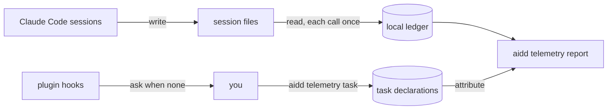

← [aidd-framework](../../README.md)

# aidd-telemetry

Counts the tokens your Claude Code sessions consume, each model call once, by person, session, model, agent, day, repository, task and ticket. Local only: nothing is sent anywhere.

> For: people who measure their work. Formats, rules and limits: [usage contract](../../aidd_docs/product/usage-contract.md).

## How it works

- Only clones that ran `aidd telemetry on` are measured, from that moment on.
- A task and a ticket come only from what you declare; nothing is guessed.
- Every axis splits the same total.

## Start

1. Install: `npm install -g @ai-driven-dev/cli`, then `aidd plugin install aidd-telemetry`. Its hooks need `node` on `PATH`.
2. In each clone to measure: `aidd telemetry on`.
3. Work. When the work has no task yet, Claude Code asks once: send `aidd telemetry task <name> [--ticket <ref>]` (or `--none`) as your next prompt, or run it in a terminal.
4. Read: `aidd telemetry report --axis task`.

## Commands

| Command | Does |
| --- | --- |
| `aidd telemetry on` / `off` | start or stop measuring this clone; what was measured stays |
| `aidd telemetry status` | whether this clone is measured, since when, and its task |
| `aidd telemetry task <name> [--ticket <ref>]` | declare the task; `--none` for no task |
| `aidd telemetry report [--axis <axis>] [--days <n>]` | what the work consumed, split along one axis; `--json` for the envelope |
| `aidd telemetry identity <id>` / `--off` | be named on your own measurement, or not |
| `aidd telemetry forget` / `--yes` | show what is kept, then erase it |

## Skills

| Skill | Use it to |
| --- | --- |
| `aidd-telemetry:00-init` | opt in, stop, set or remove your identity, forget |
| `aidd-telemetry:01-usage` | ask what a period, a task or a ticket consumed |

## Privacy

- Consent is per clone and never committed: a teammate who pulls is not measured until they run `on`.
- Data stays in `~/.config/aidd/telemetry` and the clone's git config; `forget --yes` erases it.
- `AIDD_TELEMETRY=0` refuses measurement everywhere.
