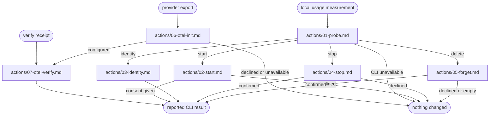

# Init

## Transversal rules

- Keep provider export and local usage measurement separate; run only the requested path.
- Apply changes through `aidd telemetry`, with the person's explicit authorization for that operation.
- Report command output and warnings with credentials redacted; a non-zero exit ends the action without retrying with other flags.
- Use only identifiers supplied by the person, rather than deriving one from git, the machine or the session.
