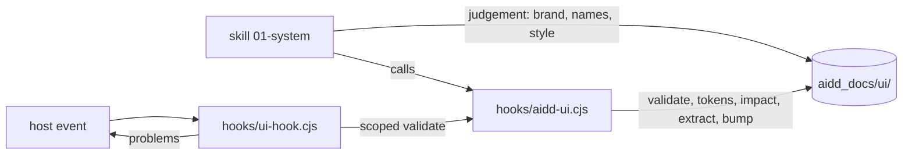

← [aidd-framework](../../README.md)

# aidd-ui

UI and UX design.

| | |
| --- | --- |
| Status | alpha |
| Install | `/plugin install aidd-ui@aidd-framework` |
| Start with | `/aidd-ui:01-system` |
| Skills, agents, hooks | [Catalog](../../docs/CATALOG.md#-aidd-ui) |
| Details | [Spec](../../aidd_docs/tasks/2026_10/2026_10_30_aidd-ui-rework/spec.md), [skill references](skills/01-system/references/engine.md) |

> [!WARNING]
> Not ready for use.
> Skills and names may change or disappear without notice.

## How it works

| Part | Owns |
| --- | --- |
| Skill, `skills/01-system/` | what to do and when: brand, names, primitives, style |
| Engine, `hooks/aidd-ui.cjs` | every rule and every write that needs no judgement |
| Hook, `hooks/ui-hook.cjs` | a host event in, the scoped `validate`, the host's output |

## Start

1. Install the plugin; its hook needs `node` on `PATH`.
2. Run `/aidd-ui:01-system` in your project.
3. Follow the skill: it writes the design system under `aidd_docs/ui/`.
4. Run `node <plugin>/hooks/aidd-ui.cjs validate` to see each rule and every problem.
5. From a checkout: `claude --plugin-dir plugins/aidd-ui`.

## Rules

- One norm lives in `aidd_docs/ui/`: `system.md`, `brand.md`, one record per element, one render per component and screen.
- The engine writes `tokens.css`, `tokens.resolver.json` and the versions; never edit them by hand.
- A problem prints as `<file>[:<line>] <rule> [warning] <message>`; the hook shows at most 10 lines, then `+N more: <command>`.
- The end of a turn that wrote under `aidd_docs/ui/` or a code root is blocked once while an error remains; warnings never block.
- A colour literal in code already committed is a warning; a new one is an error.
- A validated element edited without a new `version` is an error.

## Limits

- Windows is untested.
- The hook command names `${CLAUDE_PLUGIN_ROOT}` unquoted, and the OpenCode and Kilo bridges replay only that form: a plugin path with spaces breaks it.
- Cursor: the stop is proven on a payload, not in `-p`.
- A shell write outside the known forms (redirection, `tee`, `sed -i`, the engine) is not seen.
- H8 and C4 read `HEAD`: without `git` or a commit they stay silent.
- Overlapping breakpoint queries cascade in the stylesheet: at a width two match, the later keeps a token the earlier alone redefines.
- A render shows a variant or state when its text holds the attribute; native behaviour (focus, validity) no render shows.
- Narrower limits and each rule: `node <plugin>/hooks/aidd-ui.cjs validate`, the spec and the skill references.
