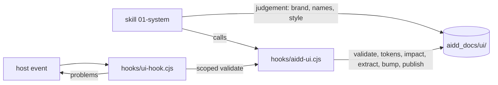

← [aidd-framework](../../README.md)

# aidd-ui

UI and UX design.

| | |
| --- | --- |
| Status | alpha |
| Install | `/plugin install aidd-ui@aidd-framework` |
| Start with | `/aidd-ui:01-system` |
| Skills, agents, hooks | [Catalog](../../docs/CATALOG.md#-aidd-ui) |

> [!WARNING]
> Not ready for use.
> Skills and names may change or disappear without notice.

## How it works

## Start

1. Install the plugin; its hook needs `node` on `PATH`.
2. Run `/aidd-ui:01-system` in your project.
3. Follow the skill: it writes the design system under `aidd_docs/ui/`.

## Limits

- Windows is untested.
- The hook command names `${CLAUDE_PLUGIN_ROOT}` unquoted, and the OpenCode and Kilo bridges replay only that form: a plugin path with spaces breaks it.
- Cursor: the stop is proven on a payload, not in `-p`.
- A shell write outside the known forms (redirection, `tee`, `sed -i`, the engine) is not seen.
- H8 and C4 read `HEAD`: without `git` or a commit, H8 stays silent and C4 counts every colour literal as new.
- Overlapping breakpoint queries cascade in the stylesheet: at a width two match, the later keeps a token the earlier alone redefines.
- A render shows a variant or state when its text holds the attribute; native behaviour (focus, validity) no render shows.
